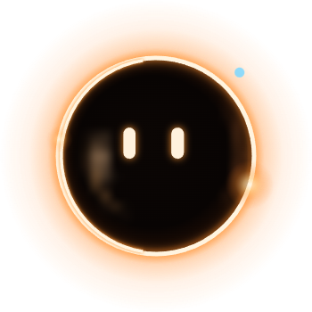
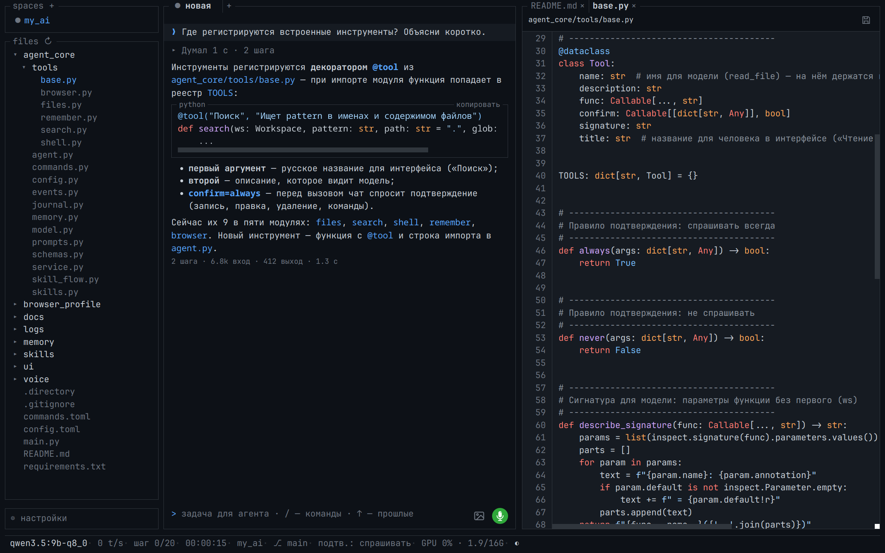
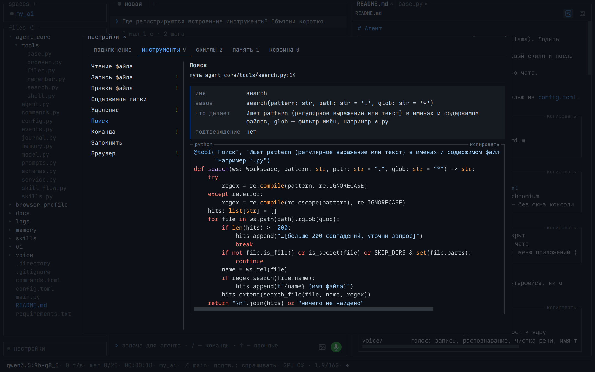

# Агент

Маленькое ядро агента на локальной модели (Ollama). Модель выбирает инструмент или скилл;
если подходящего нет — предлагает написать новый скилл и после подтверждения пишет его сама.
Интерфейс — мини-виджет «Ася» с голосом и окно чата.

## Установка (без прав администратора)

Нужны Python 3.11+ и запущенная Ollama с моделью из `config.toml`.

Linux:

    python3 -m venv .venv
    .venv/bin/pip install -r requirements.txt
    .venv/bin/python -m playwright install chromium
    .venv/bin/python main.py

Windows (PowerShell):

    python -m venv .venv
    .venv\Scripts\pip install -r requirements.txt
    .venv\Scripts\python -m playwright install chromium
    .venv\Scripts\pythonw main.py    # pythonw — без окна консоли

Точка входа одна — `main.py`:

    python main.py              # виджет, чат скрыт
    python main.py --chat       # сразу с окном чата
    python main.py --shortcut   # ярлык «Агент»: меню приложений (Linux) или «Пуск» (Windows, через pythonw)

## Как устроено

Три независимые папки: ядро не знает ни об интерфейсе, ни о голосе; голос не знает ни о ядре, ни об
интерфейсе; интерфейс связывает их.

    agent_core/   ядро агента — без интерфейса
    main.py       точка входа
    ui/           десктопный интерфейс: окна, мост к ядру
    voice/        голос: запись, распознавание, чистка речи, имя-триггер, голосовой ответ
    wiki/         вики: заметки, сырые источники, каталог, граф, агент вики (опирается на ядро, ядро о ней не знает)

### `agent_core/` — ядро

| Модуль | Что делает |
|---|---|
| `agent.py` | `Agent`: луп «модель выбирает действие — код выполняет», подтверждения |
| `service.py` | служебные команды: `/помощь`, `/продолжить`, `/модель`, `/проект`… |
| `skill_flow.py` | «нужен скилл» → модель пишет код → подтверждение → установка → повтор задачи |
| `model.py` | клиент Ollama через Instructor: схема ответа, повторы, потоковый черновик |
| `prompts.py` | системный промпт, промпт для скилла, список служебных команд |
| `schemas.py` | схемы ответа модели: вызов инструмента, ответ, запрос скилла, код скилла |
| `tools/` | встроенные инструменты, по модулю на группу: `files` (чтение, запись, правка, дерево, удаление в корзину), `search`, `shell` (команды), `remember` (память), `browser` (Playwright: одно окно на процесс, постоянный профиль, подсветка элемента); `base` — `@tool`, реестр `TOOLS`, `Workspace` |
| `skills.py` | скиллы `skills/<имя>/`: загрузка, запуск в отдельном процессе, сохранение |
| `commands.py` | быстрые команды из `commands.toml` |
| `journal.py` | журнал сессии `logs/*.jsonl` — он же история для модели |
| `memory.py` | долговременная память `memory/memory.md` |
| `events.py` | контракт с интерфейсом: `Event`, `Status` |
| `config.py` | `Config` из `config.toml` и пути к данным |

### `ui/` — интерфейс

- `app.py` — запуск окон pywebview, связка ядра, голоса и окон, разбор аргументов `main.py`.
- `shortcut.py` — ярлык «Агент» для `main.py --shortcut`.
- `bridge.py` — мост Python↔JS: `ChatApi` и `WidgetApi`; события ядра идут в окно через `run_js`
  (token склеиваются, не чаще 20 раз/с). Каждая вкладка чата — свой `Agent` со своим журналом.
- `cursor.py` + `kwin_cursor.js` — где курсор на экране (глаза виджета следят за мышкой): Windows —
  GetCursorPos, KDE на Wayland — скрипт KWin по D-Bus, X11 — XQueryPointer.
- `widget/`, `chat/` — страницы окон; `theme.css` — цвета; `vendor/` — библиотеки (офлайн).
- `state.json` — позиция виджета, пространства, шрифт, тема (не история — она в журналах ядра).

Окна — pywebview: на Windows встроенный WebView2, на Linux — Qt из pip (`pywebview[qt]`).

### `voice/` — голос

- `assistant.py` — `VoiceAssistant`: запись → Whisper → чистка → буфер обмена или поле чата, имя-триггер,
  голосовой ответ. Состояния отдаёт в `on_state`, адрес Ollama получает от того, кто его создаёт.
- `audio.py` (запись 16 кГц, громкость, звуки), `stt.py` (faster-whisper), `cleanup.py` (чистка речи),
  `wake.py` (имя «Ася»: Vosk, запасной — openWakeWord), `tts.py` (голосовой ответ), `clipboard.py`.
- `models/` — Vosk (`vosk-model-small-ru-0.22`,
  [скачать](https://alphacephei.com/vosk/models/vosk-model-small-ru-0.22.zip)) и запасной голос Piper
  (`piper/ru_RU-irina-medium`, [скачать](https://huggingface.co/rhasspy/piper-voices/tree/v1.0.0/ru/ru_RU)).
- `phrases/` — готовые фразы голосом Аси (WAV + `index.json`); делаются в `~/my_projects/my_voice_ai`.

### `wiki/` — вики

- `store.py` — `Wiki`: заметки `notes/<раздел>/<имя>.md`, сырые тексты `raw/`, каталог `index.md` и журнал `log.md`
  (их пишет код после каждой правки), прежние версии — `.history/`, удалённые — `.trash/`; граф и поиск.
- `tools.py` — инструменты агента вики: `wiki_read`, `wiki_search`, `wiki_create`, `wiki_append`, `wiki_edit`
  (в общий реестр `TOOLS` не попадают).
- `agent.py` — `WikiAgent`: луп ядра со своим промптом (в нём каталог вики), только инструментами вики и тремя
  последними сообщениями; без памяти и скиллов. Длинное сообщение сначала сохраняется в `raw/`.
- `ui/` — раздел «Вики» окна чата: `wiki.js` (дерево, заметка, чат агента), `graph.js` (граф на SVG), `wiki.css`.
  pywebview отдаёт окна со своего HTTP-сервера с корнем `ui/`, ссылкой из страницы их не загрузить: `assets.py`
  собирает их в один скрипт, и `ui/app.py` выполняет его в окне чата после загрузки (`run_js`).

### Данные (в корне проекта)

- `config.toml` — настройки ядра; секции `[ui]` и `[voice]` — интерфейса и голоса (ядро их пропускает).
- `commands.toml` — быстрые команды без модели: фраза → скилл.
- `skills/<имя>/` — `SKILL.md` (name, description, args, libs) и `run.py` с `main(**args) -> str`;
  секреты скилла — в `skills/<имя>/.env`, модель их не видит.
- `memory/memory.md` — долговременная память, строки-факты.
- `logs/*.jsonl` — журнал шагов; `/продолжить` поднимает последнюю сессию. `logs/app.log` — лог интерфейса.
- `browser_profile/` — профиль браузера агента: куки и вход на сайты сохраняются между запусками.
- `wiki_data/` — вики (папка — `[wiki] dir` в `config.toml`); журналы чата вики — в её `.chat/`.

## Виджет «Ася»

Затмение: тёмный диск, раскалённое кольцо, тёплая корона; внутри текут отражения, как в стеклянном шаре.
Глаза следят за мышкой по всему экрану, моргают; курсор над виджетом — радуются; долго без движения мыши —
засыпает.

- Клик — запись (повторный клик или 1,5 с тишины — стоп), чистый текст — в буфер обмена. Если Ollama
  недоступна — в буфер идёт сырой текст Whisper.
- Двойной клик — чат; правый клик — меню справа сверху от головы (у края экрана — где хватает места): открыть чат,
  отправить последний текст в чат, слушать фон «Ася», выход; перетаскивается мышью.
- Пока чат открыт, голова скрыта; чат закрыли или свернули — голова снова на экране.
- «Ася» (фон слушается — голубая точка на кольце): отвечает голосом «Да, слушаю», потом запись — как после клика.
- Запись: капля отрывается от кольца, становится шариком и пускает круги в такт голосу.
- Думает — бусина бежит по кольцу; готово — довольные глаза и «скопировано»; ошибка — × ×, текст в подсказке;
  агент ждёт подтверждения — корона мигает жёлтым.

Имя, фраза ответа, голос и прочее — `[voice]` в `config.toml` (`wake_words`, `reply`, `tts_voice`…);
слежение за мышкой — `follow_mouse` в `[ui]`.

## Чат

Слева — пространства (папки проектов), под ними «files» — дерево активного пространства (папки раскрываются
кликом, ↻ — перечитать; после ответа агента дерево обновляется само). Клик по файлу открывает его справа от чата
во вкладке редактора (граница тянется, двойной клик — пополам; закрыли последнюю вкладку — чат снова на всю ширину).
Вкладки свои у каждого пространства. Подсветка синтаксиса, номера строк, Tab — отступ, Enter — с отступом строки;
ctrl+s — сохранить сразу, ctrl+w или × на вкладке — закрыть (с несохранёнными правками — «сохранить / не сохранять /
отмена»). Файл поменяли на диске после открытия (например, агент) — при сохранении спросит, перезаписать ли.
Markdown: кнопка просмотра (как в VS Code, ctrl+shift+v) переключает сырой текст и отрисованный вид.
Не открываются двоичные файлы, не UTF-8 и больше 2 МБ.

Картинки к сообщению: ctrl+v, перетащить в окно или значок картинки у поля ввода; над полем — миниатюры (× — убрать),
больше 1600 px уменьшаются. Модель видит их сама (нужна модель с vision — `ollama show <модель>`); файлы лежат
в `logs/images/`, журнал ссылается на них, в историю модели идут картинки двух последних таких сообщений.

Внизу — «⚙ настройки» (ctrl+,; закрываются ×, Esc или кликом мимо окна): окно со вкладками.

- **подключение** — адрес Ollama, модель (список из `ollama list`, можно вписать свою), размышления; «проверить» —
  отвечает ли Ollama и есть ли такая модель; «сохранить» пишет в `config.toml` (комментарии остаются)
  и действует для всех сессий со следующего шага;
- **инструменты** и **скиллы** — список слева, справа карточка: путь, поля, код (оранжевый «!» — спрашивает
  подтверждение);
- **память** — `memory/memory.md` в редакторе: факт — строка, поправить, удалить ×, добавить, «сохранить»;
- **корзина** — убранные пространства: вернуть или убрать насовсем; папку на диске это не трогает.

На задачу — 20 шагов (`max_steps`); кончились — в чате карточка «Продолжить?»: «продолжить» даёт ещё столько же,
«стоп» — остановиться.

Пространство убирается значком корзины (виден при наведении); последнее пространство убрать нельзя.

ctrl+n — новая сессия, ctrl+b — левая колонка, ctrl+, — настройки, ctrl+o — раскрыть/свернуть последний блок шагов,
ctrl+k — пространства, esc — стоп, ctrl+плюс/минус/0 — шрифт, Enter — отправить, Shift+Enter — новая строка,
↑ — прошлые сообщения, `/` — быстрые команды, микрофон — диктовка в поле: слова появляются по ходу речи
(черновик Vosk), в конце заменяются точным текстом Whisper; моделью не чистятся (`dictate_cleanup`), отправляете вы. Клик по модели в строке статуса —
выбор из `ollama list`, ◐ — светлая/тёмная тема.

## Контракт ядро ↔ интерфейс

    from agent_core.agent import Agent
    from agent_core.config import Config
    agent = Agent(Config.load())
    for event in agent.send("прочитай README"):     # генератор событий Event(type, text, data, id); images=[пути]
        if event.type in ("confirm_request", "need_skill", "continue_request"):
            agent.confirm(event.id, "yes")           # "yes" | "no" | "session"; можно из другого потока
    agent.stop()                                     # прервать луп из другого потока
    agent.status()                                   # Status: модель, контекст, токены, ток/с, сессия, папка, ветка, шаг
    agent.skills()                                   # list[SkillInfo]
    agent.tools()                                    # встроенные инструменты: name, signature, description, confirm
    agent.history()                                  # записи журнала сессии — по ним восстанавливается лента
    agent.memory_facts(); agent.save_memory(facts)   # долговременная память: прочитать / заменить целиком
    agent.configure(model=..., base_url=...)         # новые настройки подключения со следующего шага
    agent.close()                                    # отдать общий браузер

Типы событий: step, tool_result, token (кусок потокового ответа; data.reset — модель начала заново),
thinking, answer, confirm_request, need_skill, continue_request (шаги кончились), error, status, info, warning.
Генератор ждёт confirm() внутри себя: в однопоточном интерфейсе вызывай confirm до следующей итерации.

## Вики

«◈ вики» в левой колонке (или Esc — обратно в чат) — раздел поверх чата: слева дерево заметок по разделам
(◆ раздел, ○ заметка, ● открытая; строка поиска — по названиям, от трёх букв — и по тексту), в центре заметка или граф,
справа — агент вики.

- Агенту вики дают сырой текст и говорят, что сделать: «создай заметку: …». Текст длиннее 200 символов сначала
  сохраняется в `raw/` как есть, заметка ссылается на него («источник» под заголовком). Перед новой заметкой агент
  смотрит каталог: есть заметка на ту же тему — спросит, дополнить её или создать новую; раздел не назван — спросит.
- Агент только создаёт, дописывает и точечно правит заметки — переписать целиком или удалить не может.
  frontmatter, «См. также», каталог `index.md` и журнал `log.md` ведёт код.
- Заметка: «правка» — редактор Markdown (ctrl+s — сохранить), «удалить» — в `.trash/` вики. Ссылки `[[имя]]`
  кликабельны, «связано» — ссылки в обе стороны.
- Граф: точка — заметка (крупнее — больше связей, цвет — раздел), линия — ссылка. Точки таскаются мышкой,
  фон двигается, колесо — масштаб, двойной клик по фону — вид по центру, щелчок по точке — открыть заметку.
- «Проверь вики» — агент по каталогу ищет дубли, заметки не в своём разделе и заметки без связей и предлагает правки.
- `[wiki] model` — своя модель агента вики (по умолчанию `qwen3.5:35b-a3b`: 9b путает разделы и выдумывает факты).
